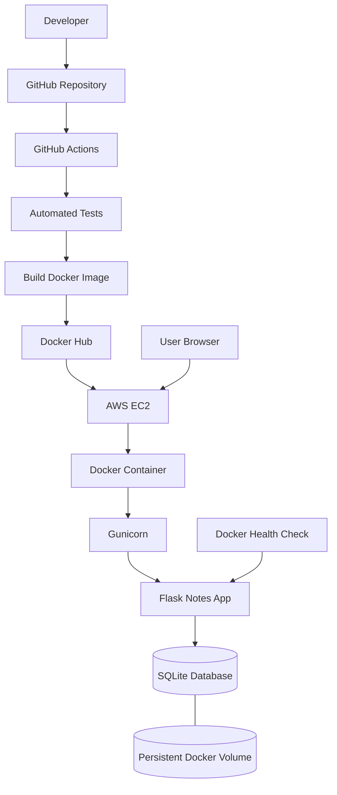

# Docker Notes App — Cloud & DevOps Capstone

A simple web-based Notes application built with Flask, containerized using Docker, and deployed on AWS EC2. This project demonstrates containerization, persistent database storage, automated testing, CI/CD, application health monitoring, and cloud deployment.

## Features

- Add and display notes through a web interface.
- Store notes persistently using SQLite.
- Run the application using Gunicorn.
- Build and run the application using Docker and Docker Compose.
- Persist database files using a named Docker volume.
- Monitor application health using a Docker `HEALTHCHECK`.
- Provide a health-check endpoint at `/health`.
- Run automated tests using pytest.
- Automate testing, Docker image building, and Docker Hub publishing using GitHub Actions.
- Deploy the containerized application on AWS EC2.

## Technologies Used

- **Programming language:** Python
- **Web framework:** Flask
- **Database:** SQLite
- **Application server:** Gunicorn
- **Containerization:** Docker
- **Container orchestration:** Docker Compose
- **CI/CD:** GitHub Actions
- **Container registry:** Docker Hub
- **Cloud platform:** AWS EC2
- **Testing:** pytest
- **Frontend:** HTML and CSS


## Architecture

The project uses GitHub Actions for CI/CD, Docker Hub for image distribution, and AWS EC2 for hosting the containerized application.




### Application deployment flow

1. A user accesses the Notes App through a web browser.
2. AWS EC2 hosts the Docker container.
3. Gunicorn serves the Flask application inside the container.
4. Flask handles requests to add and display notes.
5. SQLite stores notes in a database file.
6. A named Docker volume preserves the database independently of the container.
7. Docker health checks monitor the application's health endpoint.

### CI/CD workflow

1. Code changes are pushed to the GitHub repository.
2. GitHub Actions checks out the source code.
3. Python dependencies are installed.
4. Automated tests run using pytest.
5. Python syntax is checked.
6. The Docker image is built.
7. On pushes to the `main` branch, GitHub Actions authenticates to Docker Hub and publishes the image.

## Run Locally

### Prerequisites

Install the following:

- Python
- Docker Desktop with Docker Compose
- Git (for cloning the repository)

### 1. Clone the repository

```bash
git clone https://github.com/Deekshal11/Simple-notes-app.git
cd Simple-notes-app
```

### 2. Build and start the application

```bash
docker compose up -d --build
```

### 3. Access the application

Open the following URLs in your browser:

- Application: http://localhost:8080
- Health endpoint: http://localhost:8080/health

The health endpoint should return:

```json
{"status":"ok"}
```

### 4. Check container status

```bash
docker compose ps
```

### 5. View application logs

```bash
docker compose logs -f web
```

### 6. Monitor resource usage

```bash
docker stats
```

### 7. Stop the application

```bash
docker compose down
```

The named Docker volume is retained when using this command. To delete the volume and its stored database, use `docker compose down -v` only when you intentionally want to remove the stored data.

## Run Automated Tests

Install the dependencies:

```bash
pip install -r requirements.txt
```

Run the test suite:

```bash
python -m pytest -v
```

The test suite verifies the home page, note creation, health endpoint, rejection of empty notes, and note persistence between requests.

## Docker Hub

The published Docker image is available at:

https://hub.docker.com/r/deekshalkulal/simple-notes-app

Pull the image:

```bash
docker pull deekshalkulal/simple-notes-app:latest
```

## AWS EC2 Deployment

The application is deployed on an AWS EC2 instance and runs inside a Docker container.

The deployment uses:

- A Docker container running Gunicorn and Flask.
- Port mapping from EC2 port 80 to container port 5000.
- An environment variable to configure the SQLite database path.
- A named Docker volume mounted at `/data`.
- A Docker health check that requests the `/health` endpoint.

Verify the container:

```bash
sudo docker ps
```

Check the health status:

```bash
sudo docker inspect --format='{{.State.Health.Status}}' notes-app
```

Inspect logs:

```bash
sudo docker logs --tail 30 notes-app
```

Test application health locally on EC2:

```bash
curl -i http://localhost/health
```

**Note:** The current EC2 deployment uses HTTP. HTTPS and a custom domain can be added as future improvements.

## GitHub Actions CI/CD

The workflow is configured in:

`.github/workflows/ci.yml`

The pipeline runs automated tests and Python syntax checks, builds the Docker image, and publishes the image to Docker Hub on pushes to `main`.

The Docker Hub credentials are configured using GitHub repository secrets:

- `DOCKERHUB_USERNAME`
- `DOCKERHUB_TOKEN`

Never commit passwords, access tokens, private keys, or other credentials to the repository.

## Learning Outcomes

Through this project, I gained hands-on experience with:

- Building and managing Docker images and containers.
- Using Docker Compose to manage application services.
- Configuring persistent data storage with SQLite and Docker volumes.
- Running Flask applications with Gunicorn.
- Writing and running automated tests with pytest.
- Implementing a CI/CD pipeline using GitHub Actions.
- Publishing Docker images to Docker Hub.
- Deploying a containerized application on AWS EC2.
- Monitoring container resources, application logs, and health status.
- Verifying deployments and troubleshooting common container issues.

## Future Improvements

- Configure HTTPS using a domain name and TLS certificate.
- Add user authentication and authorization.
- Consider a managed database for a larger deployment.
- Improve monitoring, alerting, and deployment automation.

## Repository

GitHub: https://github.com/Deekshal11/Simple-notes-app

Docker Hub: https://hub.docker.com/r/deekshalkulal/simple-notes-app
